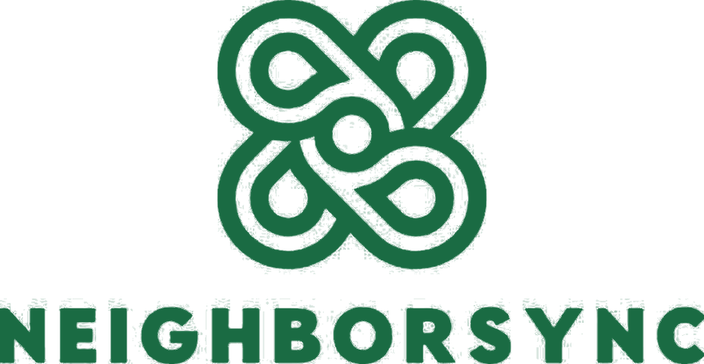

<p align="center">
  
</p>

<p align="center">
  A management platform for homeowners association subdivisions: dues, requests, gate passes, complaints and community news in one place.
</p>

<p align="center">
  <a href="https://neighbor-sync.vercel.app"><strong>Live site</strong></a>
</p>

---

NeighborSync replaces the paper forms, ledgers and group chats an HOA usually runs on. Residents use it to pay dues and file requests. Officers use it to review those requests, keep the books and run the gate.

It is a capstone project for the BSIT program at Lyceum of the Philippines University, Cavite Campus, piloted with a homeowners association. Each phase of a subdivision runs as its own association, with its own officers, dues and records.

## Who it is for

| Role | What they do |
|---|---|
| **Homeowner / Tenant** | Check balances, send proof of payment, file complaints, request permits and gate passes, book facilities |
| **Treasurer** | Issue bills, verify payments, manage budgets and payment channels |
| **Secretary / President** | Approve accounts, handle complaints and requests, post announcements |
| **Security** | Log visitors and incidents, scan gate passes |
| **Audit Officer** | Read-only oversight of finance, operations and the audit trail |
| **Super Admin** | Runs the system across all phases |
| **Visitor** | Sees the public map, announcements and events without signing in |

## Features

**Money**
- Billing, payments, official receipts and statements as PDF
- Residents send proof of payment; officers review it before it counts
- GCash, Maya and bank QR codes for each phase
- Budgets with expenses tracked against each category

**Requests and cases**
- Permits, move in/out, vehicle registration and facility reservations
- Complaints, violations and security incidents with status tracking
- Reservations that cannot double-book, priced from the facility's rates

**At the gate**
- QR gate passes that residents can save as an image and send to a guest
- Guards scan a pass to see its status and the host's details
- Visitor logs that flag overstays based on the purpose of the visit

**Community**
- Announcements, events and a shared calendar, with waste collection days
- Community map with lot pins, per phase
- Document storage with private and shared folders
- A CMS for branding, the landing page, contact details and legal text

**Administration**
- Bulk homeowner import from CSV or Excel, with a preview before anything is saved
- Account approval with proof of ownership
- A database-level audit trail, backups and restore, reports and charts
- Two-factor sign-in by authenticator app or emailed code
- A first-run guided tour and step-by-step help for each role
- English and Filipino interface options, with translation still partial
- An offline mode for officers

## How complaints get sorted

New complaints and incidents are classified automatically to suggest a category and a priority. Gemini is tried first, then Claude if it is configured. If neither answers, a local model takes over: Naive Bayes for the category and a VADER-style sentiment score for the priority, both trained for English and Filipino. Officers can always overrule the suggestion, and every result records which engine produced it.

## Security

Access rules live in the database, so they hold no matter which client makes the request.

- **Row-level security** is on for every table, with roles and permissions stored as data.
- **Phase isolation** is enforced with restrictive policies, so one association cannot read another's records.
- **Column guards** are triggers that stop a resident from changing officer-owned fields, such as a request's approval status.
- **The audit trail** is written by database triggers, so a client cannot skip it or forge who made a change.
- **Private files** are served through short-lived signed links.

The Supabase anon key is compiled into the web app and is public by design. These database rules are what protect the data.

## Tech stack

| Layer | Tools |
|---|---|
| App | Flutter and Dart, `go_router`, `drift` (offline storage) |
| Backend | Supabase: Postgres, Auth, Storage, Realtime, Edge Functions (TypeScript on Deno) |
| Hosting | Vercel for the web build |
| Targets | Web (live) and Android |

## Project layout

```
lib/
  core/       shared rules, module definitions, helpers
  screens/    one file per screen
  services/   Supabase and generic data access
  widgets/    shared UI, navigation shells, dialogs
  offline/    local database and sync
  theme/      colours and styles
supabase/functions/   Edge Functions (classification, moderation, backups, account actions)
email_templates/      Supabase Auth email bodies
web/                  web entry point, icons, offline database worker
```

## Running it

You need the Flutter SDK (Dart 3.3 or newer) and your own Supabase project.

> **The database schema is not in this repository.** Tables, policies and triggers were built directly on the live project, so a new Supabase project will not work until that schema is recreated.

Create a `.env` file in the project root. It is gitignored:

```
SUPABASE_URL=https://your-project.supabase.co
SUPABASE_ANON_KEY=your-anon-key
```

Then run:

```bash
flutter pub get
flutter run -d chrome --dart-define-from-file=.env
```

Web deploys use `vercel-build.sh`, which reads the same two values from Vercel's environment variables.

Edge Functions deploy separately from the web app:

```bash
supabase functions deploy classify-complaint --project-ref your-project-ref
```

AI classification is optional. Set `GEMINI_API_KEY` or `ANTHROPIC_API_KEY` as a Supabase secret to turn it on. Without either key, the local model does the work.

## Status

Under active development as a capstone project. There are no automated tests yet; features have been checked by hand and against the database.

## License

No license has been chosen, so all rights are reserved. You are welcome to read the code, but ask before reusing it.
